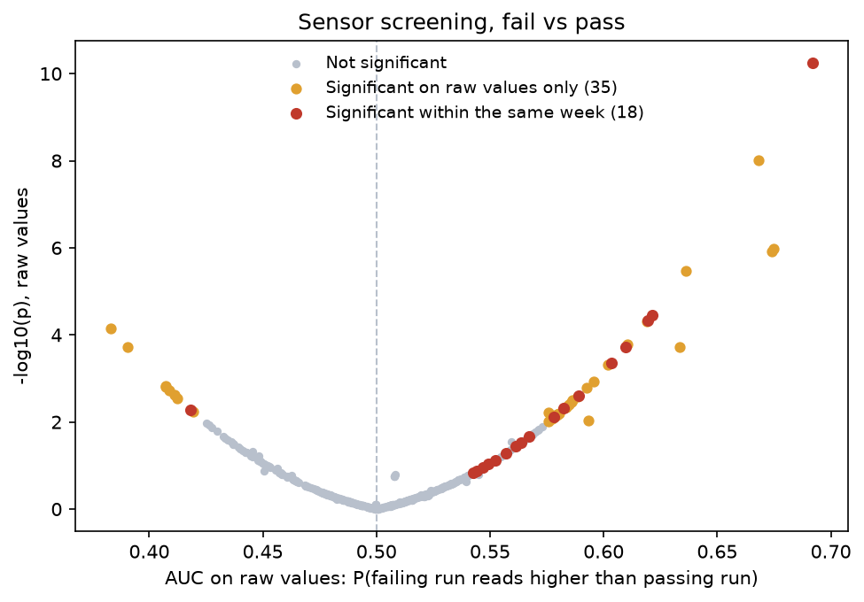
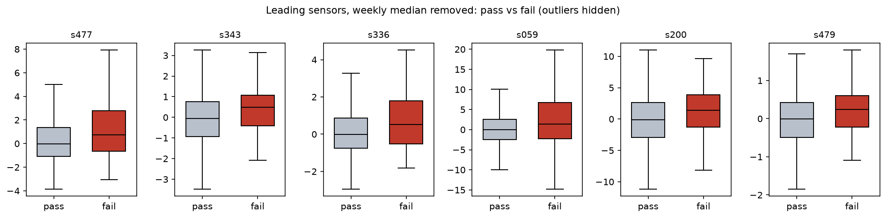

# SECOM Yield Loss Root-Cause Screening (secom-root-cause)

[](https://github.com/litaoshu0727-del/secom-root-cause/actions/workflows/tests.yml)

**English** | [中文](README.zh-CN.md)

**In one sentence:** screen the 590 sensors of a real production line for candidates linked to failing runs, and show that most of the apparent links are only a time trend.

| What | Result |
|---|---|
| Test each sensor, controlling the false discovery rate | 44 candidates out of 446 usable sensors |
| Check whether the fail rate changes over time | Down from 8.6% to 4.7% over three months |
| Predict fails from production time alone, without any sensor | ROC-AUC 0.69; models using every sensor reach only 0.71–0.76 |
| Compare fails and passes only within the same week | Candidates shrink from 44 to 18, belonging to 12 independent signals |
| Predict the future from the past instead of random cross-validation | ROC-AUC falls from 0.71–0.76 to 0.52–0.55 |

Conclusion: the data supports "a small group of sensors is worth an engineer's attention", not "fails can be predicted from the sensors".


SECOM is data from a real semiconductor production line: 1,567 production runs, 590 sensor readings, a pass/fail outcome and a timestamp, with only 104 fails. This project asks:

1. **Is the fail rate stable?** Monitor it weekly with a p chart and find abnormal periods.
2. **Which sensors are linked to fails?** Test each sensor and control the false discovery rate.
3. **Are these leads reliable?** Check whether they are just drifting with time, whether they duplicate the same signal, and whether they are still selected on half of the data.
4. **How well can fails be predicted?** Evaluate with random cross-validation and with "predict the future from the past".

## Conclusions

**Most sensors in SECOM that look "related to fails" are really related to time.**

- The fail rate drops clearly over three months: 8.6% in the first half of the runs, 4.7% in the second.
- Knowing only when a run happened, without looking at any sensor, predicts fails with ROC-AUC 0.69; models with all 446 sensors reach 0.71–0.76, only a little more.
- Trained on the first 70% of runs and tested on the last 30%, all three models drop to ROC-AUC 0.52–0.55, close to guessing.
- Standard screening selects 44 sensors; after comparing fails and passes only within the same week, 18 remain, 14 of them in a small group of sensors with related numbers.

So what this data supports is "a small group of sensors is worth an engineer's attention", not "fails can be predicted from the sensors".

## Why not just train a classifier

590 sensors and 104 fails is the classic "many features, few samples" setting. Modelling directly has these traps, each handled here:

| Trap | What is done |
|---|---|
| Testing hundreds of sensors at p < 0.05 gives twenty-odd by pure chance | Benjamini-Hochberg correction, selection by q-value |
| Selecting features on all the data before cross-validating inflates the score | Imputation, scaling and feature selection all sit inside the pipeline and are refitted in every fold |
| Sensors drift over time and so does the fail rate, so the two correlate spuriously | Screen again after subtracting each sensor's weekly median, comparing fails and passes only within the same week |
| Random cross-validation puts runs from the same period in both training and test, overstating real performance | Also evaluate on a split in time order, and compare with a model that uses time only |
| Features picked by a single L1 regression are partly chance | Stability selection: repeat on 100 random halves of the data and count how often each is picked |
| After imputation the "sensor dropped out" signal is gone | Test missingness against fails separately, on the raw data |
| Highly correlated sensors repeat in the list | Group by Spearman correlation ≥ 0.95 and keep one representative per group |

The sensors are anonymous, so the output is "a shortlist of sensors worth an engineer's look", not a definite physical root cause.

## Quick start

```bash
pip install -e ".[dev]"
pytest                                             # 12 tests
python -m secom.synthetic --out data/synthetic
python -m secom.report --data data/synthetic --out reports/synthetic
```

## Getting the real data

1. Download `secom.zip` from the UCI SECOM page (https://archive.ics.uci.edu/dataset/179/secom). If it does not open, the Internet Archive has a copy of the official file: `https://web.archive.org/web/2026/https://archive.ics.uci.edu/static/public/179/secom.zip`.
2. Unpack `secom.data` and `secom_labels.data` into `data/secom/`.
3. Run `python -m secom.report --data data/secom --out reports/secom`.

The dataset is not included in the repository. SECOM is published under CC BY 4.0; source: M. McCann, A. Johnston, *SECOM* [Dataset], UCI Machine Learning Repository, 2008. [doi:10.24432/C54305](https://doi.org/10.24432/C54305)

## Results on the real data

Data: 1,567 runs, 104 fails (6.6%), from 2008-07-19 to 2008-10-17. Of the 590 sensors, 116 are constant and 28 are missing more than half their values, leaving 446 for analysis.

**The fail rate changes over time**

- In the first six weeks the weekly fail rate is 10%–23%; in September it falls to 1%–4%.
- With 3σ control limits only 1 of 14 weeks is out of control (the week of 28 July, 10 fails in 48 runs); but the difference between the two halves is clear (8.6% against 4.7%, Fisher test p = 0.002).

**Sensor screening**

| Screening | Sensors selected | Independent groups |
|---|---|---|
| Raw p < 0.05, uncorrected | 86 (about 22 expected by chance) | – |
| Raw readings, q < 0.1 | 44 | 33 |
| After subtracting the weekly median, q < 0.1 | 18 | 12 |

- Of the 44 from standard screening, 20 drift clearly over time, and only 9 remain significant when compared within the same week.
- 14 of the remaining 18 belong to sensors 197, 200, 203, 205 and 207 and those numbers plus 136 and plus 272 (for example 205 / 341 / 477). The sensors are anonymous; this numbering pattern may mean they are different statistics of the same measurement, but that is a guess.
- The effects are all small: within the same week, the chance that a fail reads higher than a pass is 0.59–0.61 (0.5 means no difference).
- s059 is the most significant on raw readings (probability 0.69, picked in 97% of stability-selection rounds), but it also drifts over time; after subtracting the weekly median it falls to 0.60 and is still significant.
- For 8 sensors, missing values are linked to fails (fails are less often missing), but their missing rate itself rises over time (s072 goes from 38% in the first half to 64% in the second), so they are not treated as leads.





**How well can fails be predicted?**

| Model | Random 5-fold × 3 ROC-AUC | Time-ordered split ROC-AUC |
|---|---|---|
| L1 logistic regression | 0.725 | 0.552 |
| Top 40 features + logistic regression | 0.710 | 0.551 |
| Random forest | 0.761 | 0.523 |
| Run order only, no sensors | 0.687 | – |

- The standard deviation over random cross-validation is about 0.04–0.05.
- The time-ordered split trains on the earliest 1,096 runs and tests on the last 471, which contain only 26 fails, so the numbers in that column are noisy too.
- PR-AUC is 0.17–0.22 with random splits (guessing gives 0.066) and 0.07–0.09 with the time-ordered split (guessing gives 0.055).

**Definitions**

- Subtracting the weekly median is conservative: a real cause that only varies from week to week would be removed as well.
- q < 0.1 means about a tenth of the list is expected to be false discoveries, roughly 2 of the 18.
- Stability selection uses raw readings, so it favours sensors that drift with time; of the 18 remaining, only s059 and s021 are picked more than half the time.

## Outputs

| File | Contents |
|---|---|
| `shortlist.csv` | Sensors that pass screening, with stability, drift and group information; the `survives` column marks those still significant within the same week |
| `screening_values.csv` | Test results for each sensor on raw readings (AUC, p-value, q-value) |
| `screening_within_week.csv` | Test results after subtracting the weekly median |
| `screening_missingness.csv` | Missingness against fails |
| `weekly_fail_rate.csv`, `p_chart.png` | Weekly fail rate and control limits |
| `model_cv.csv`, `model_time_holdout.csv` | ROC-AUC and PR-AUC of the three models under both splits |
| `volcano.png`, `top_sensors.png`, `stability.png` | Screening results, distributions of the leading sensors, stability selection |

The `auc` in `shortlist.csv` is the probability that a fail reads higher than a pass; 0.5 means no difference.

## Layout

| File | Purpose |
|---|---|
| `secom/data.py` | Read the files, sort by time, drop constant and mostly missing columns, group by correlation |
| `secom/screening.py` | Mann-Whitney tests, Fisher tests on missingness, FDR correction |
| `secom/drift.py` | p chart, sensor drift |
| `secom/model.py` | Three models, two evaluation schemes, stability selection |
| `secom/report.py` | Run everything and assemble the shortlist |
| `secom/synthetic.py` | Synthetic data with known causes |

## Checking the method on synthetic data

`secom/synthetic.py` writes data in exactly the SECOM file format, with the answers planted in advance: 8 real causes, 6 near-copies of them, 20 sensors that only drift and are unrelated to fails, 2 sensors that tend to drop out on fails, and a two-week rise in the fail rate. The tests use it to check that:

- The planted causes are recovered by screening, with the share of false discoveries under control.
- The drop-out sensors are found by the missingness test.
- A sensor that only changes with time, with no within-week link to fails, is significant on raw readings and no longer significant after subtracting the weekly median.

This only shows that the method and code are right; it is not a finding about SECOM.

## Related projects

- [wafer-map-yield](https://github.com/litaoshu0727-del/wafer-map-yield): wafer map yield analysis and defect pattern classification
- [yield-dashboard](https://github.com/litaoshu0727-del/yield-dashboard): yield monitoring dashboard (SPC, yield models)

## License

The code is under the MIT license, see [LICENSE](LICENSE). The SECOM dataset is used under CC BY 4.0 and must be credited as above.
