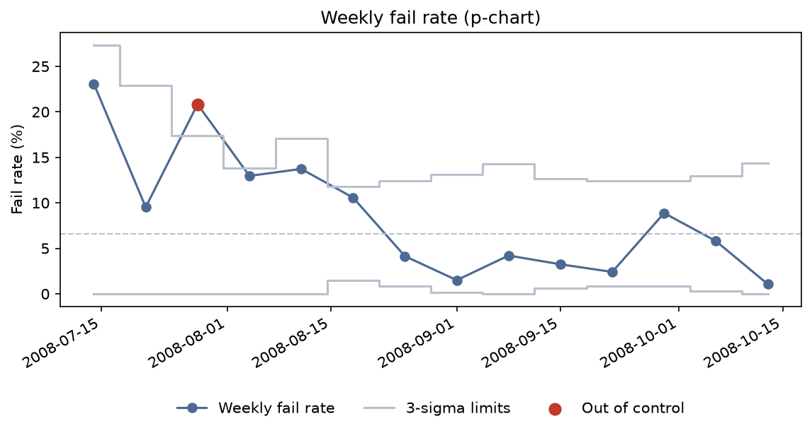

# SECOM 良率损失根因筛查 (secom-root-cause)

[](https://github.com/litaoshu0727-del/secom-root-cause/actions/workflows/tests.yml)

**一句话**:从一条真实产线的 590 个传感器里筛出和 fail 有关的候选,并证明其中大部分"相关"只是时间趋势造成的。

| 做了什么 | 结果 |
|---|---|
| 逐个传感器做检验,控制假发现率 | 446 个有效传感器里筛出 44 个候选 |
| 检查 fail 率是否随时间变化 | 三个月里从 8.6% 降到 4.7% |
| 只用生产时间、不看传感器来预测 fail | ROC-AUC 0.69;用全部传感器的模型也只有 0.71–0.76 |
| 只在同一周内比较 fail 和 pass | 候选从 44 个缩到 18 个,属于 12 个独立信号 |
| 用过去的数据预测未来,代替随机交叉验证 | ROC-AUC 从 0.71–0.76 掉到 0.52–0.55 |

结论:这份数据能支持"有一小组传感器值得工程师去查",不能支持"可以用传感器预测 fail"。



SECOM 是一条真实半导体产线的数据:1567 次生产记录、590 个传感器读数、pass/fail 结果和时间戳,其中只有 104 次 fail。本项目回答:

1. **fail 率稳定吗?** 用 p 控制图按周监控,找出异常的时间段。
2. **哪些传感器和 fail 有关?** 逐个传感器做检验,并控制假发现率。
3. **这些线索可靠吗?** 检查它们是否只是随时间漂移、是否是同一信号的重复、换一半数据是否还能被选中。
4. **fail 能预测到什么程度?** 分别用随机交叉验证和"用过去预测未来"两种方式评估。

## 结论

**SECOM 里大部分"和 fail 相关"的传感器,其实只是和时间相关。**

- fail 率在三个月里明显下降:前一半记录是 8.6%,后一半是 4.7%。
- 只知道一次生产发生在什么时候、完全不看传感器,就能把 fail 预测到 ROC-AUC 0.69;用全部 446 个传感器的模型是 0.71–0.76,只多出一点。
- 用前 70% 的记录训练、预测后 30%,三个模型的 ROC-AUC 都掉到 0.52–0.55,接近瞎猜。
- 常规筛查选出 44 个传感器;只在同一周内比较 fail 和 pass 之后,剩下 18 个,其中 14 个集中在编号相邻的一小组传感器上。

所以这份数据能支持的结论是"有一小组传感器值得工程师去查",而不是"可以用传感器预测 fail"。

## 为什么不直接训练一个分类器

590 个传感器、104 个 fail,这是典型的"特征多、样本少"。直接建模有三个陷阱,本项目逐一处理:

| 陷阱 | 处理方式 |
|---|---|
| 检验几百个传感器,按 p < 0.05 会有二十多个纯属偶然 | Benjamini-Hochberg 校正,按 q 值筛选 |
| 先在全部数据上挑特征再做交叉验证,分数虚高 | 填补缺失、标准化、特征选择全部放进 pipeline,每一折重新拟合 |
| 传感器随时间漂移,fail 率也随时间变化,两者会假相关 | 每个传感器减去当周中位数后再筛查一次,只比较同一周内的 fail 和 pass |
| 随机交叉验证把同一时期的记录分到训练和测试两边,高估实际表现 | 另外按时间顺序划分评估,并和"只用时间"的模型对比 |
| 单次 L1 回归选出的特征带偶然性 | 稳定性选择:在 100 个随机半数样本上重复,统计入选频率 |
| 缺失值填补后,"传感器掉线"这个信号消失 | 在原始数据上单独检验缺失与 fail 的关系 |
| 高度相关的传感器在名单里重复出现 | 按 Spearman 相关 ≥ 0.95 分组,每组只保留一个代表 |

传感器是匿名的,所以输出是"值得工程师去查的候选传感器名单",不是确定的物理根因。

## 快速开始

```bash
pip install -e ".[dev]"
pytest                                             # 12 项测试
python -m secom.synthetic --out data/synthetic
python -m secom.report --data data/synthetic --out reports/synthetic
```

## 获取真实数据

1. 从 UCI 的 SECOM 页面(https://archive.ics.uci.edu/dataset/179/secom)下载 `secom.zip`。如果打不开,互联网档案馆有官方文件的存档:`https://web.archive.org/web/2026/https://archive.ics.uci.edu/static/public/179/secom.zip`。
2. 解压出 `secom.data` 和 `secom_labels.data`,放到 `data/secom/`。
3. 运行 `python -m secom.report --data data/secom --out reports/secom`。

数据集不包含在仓库里。SECOM 以 CC BY 4.0 许可发布,出处:M. McCann, A. Johnston, *SECOM* [Dataset], UCI Machine Learning Repository, 2008. [doi:10.24432/C54305](https://doi.org/10.24432/C54305)

## 真实数据结果

数据:1567 次记录、104 次 fail(6.6%),时间从 2008-07-19 到 2008-10-17。590 个传感器里 116 个是常数、28 个缺失超过一半,剩 446 个用于分析。

**fail 率随时间变化**

- 前六周每周 fail 率在 10%–23% 之间,9 月降到 1%–4%。
- 按 3σ 控制限,14 周里只有 1 周失控(7 月 28 日那周,48 次记录里 10 次 fail);但前后两半的差别很明确(8.6% 对 4.7%,Fisher 检验 p = 0.002)。

**传感器筛查**

| 筛查方式 | 选出的传感器 | 独立分组 |
|---|---|---|
| 原始 p < 0.05,不校正 | 86(纯偶然预期约 22) | – |
| 原始读数,q < 0.1 | 44 | 33 |
| 减去当周中位数后,q < 0.1 | 18 | 12 |

- 44 个常规筛查的结果里,20 个随时间明显漂移,只有 9 个在同一周内比较后仍然显著。
- 留下的 18 个里,14 个属于编号 197、200、203、205、207 以及它们加 136、加 272 的传感器(如 205 / 341 / 477)。传感器是匿名的,这种编号规律可能意味着它们是同一组测量的不同统计量,这一点是推测。
- 效应都不大:同一周内,fail 的读数高于 pass 的概率在 0.59–0.61 之间(0.5 表示没有差别)。
- s059 在原始读数上最显著(概率 0.69,稳定性选择入选率 97%),但它也随时间漂移;扣除周中位数后降到 0.60,仍然显著。
- 有 8 个传感器的缺失和 fail 相关(fail 时反而更少缺失),但它们的缺失率本身随时间上升(如 s072 从前一半的 38% 升到后一半的 64%),所以不作为线索。


**fail 能预测到什么程度**

| 模型 | 随机 5 折 × 3 次 ROC-AUC | 按时间划分 ROC-AUC |
|---|---|---|
| L1 逻辑回归 | 0.725 | 0.552 |
| 前 40 个特征 + 逻辑回归 | 0.710 | 0.551 |
| 随机森林 | 0.761 | 0.523 |
| 只用记录顺序,不看传感器 | 0.687 | – |

- 随机交叉验证的标准差约 0.04–0.05。
- 按时间划分是用最早的 1096 次记录训练、最后 471 次测试,测试集里只有 26 次 fail,所以这一列的数字本身波动也大。
- PR-AUC 在随机划分下是 0.17–0.22(瞎猜是 0.066),按时间划分是 0.07–0.09(瞎猜是 0.055)。

**口径说明**

- "减去当周中位数"是保守的做法:如果一个真实原因只在周与周之间变化,也会被一起去掉。
- q < 0.1 意味着名单里预期有约一成是假发现,18 个里大概 2 个。
- 稳定性选择用的是原始读数,所以它偏向随时间漂移的传感器;留下的 18 个里只有 s059 和 s021 入选率超过一半。

## 输出

| 文件 | 内容 |
|---|---|
| `shortlist.csv` | 通过筛查的传感器,附稳定性、漂移和分组信息;`survives` 列标记同一周内仍显著的 |
| `screening_values.csv` | 每个传感器在原始读数上的检验结果(AUC、p 值、q 值) |
| `screening_within_week.csv` | 减去当周中位数后的检验结果 |
| `screening_missingness.csv` | 缺失与 fail 的关系 |
| `weekly_fail_rate.csv`、`p_chart.png` | 每周 fail 率与控制限 |
| `model_cv.csv`、`model_time_holdout.csv` | 三个模型在两种划分下的 ROC-AUC 与 PR-AUC |
| `volcano.png`、`top_sensors.png`、`stability.png` | 筛查结果、领先传感器的分布、稳定性选择 |

`shortlist.csv` 里的 `auc` 是"一次 fail 的读数高于一次 pass 的读数"的概率,0.5 表示没有差别。

## 目录

| 文件 | 作用 |
|---|---|
| `secom/data.py` | 读取文件、按时间排序、去掉常数列和缺失过多的列、相关性分组 |
| `secom/screening.py` | Mann-Whitney 检验、缺失性 Fisher 检验、FDR 校正 |
| `secom/drift.py` | p 控制图、传感器漂移 |
| `secom/model.py` | 三个模型、两种评估方式、稳定性选择 |
| `secom/report.py` | 一键运行并汇总成候选名单 |
| `secom/synthetic.py` | 生成带已知原因的合成数据 |

## 用合成数据验证方法

`secom/synthetic.py` 生成和 SECOM 文件格式完全一致的数据,并预先埋好答案:8 个真实原因、6 个它们的近似副本、20 个只漂移不相关的传感器、2 个"fail 时容易掉线"的传感器,以及一段两周的 fail 率升高。测试用它检查:

- 埋入的原因能被筛查找回,假发现的比例受控。
- 掉线传感器能被缺失性检验找到。
- 一个只随时间变化、和 fail 没有周内关系的传感器,在原始读数上显著,扣除周中位数后不再显著。

这些只说明方法和代码是对的,不是 SECOM 的结论。

## 相关项目

- [wafer-map-yield](https://github.com/litaoshu0727-del/wafer-map-yield):晶圆图良率分析和缺陷图案分类
- [yield-dashboard](https://github.com/litaoshu0727-del/yield-dashboard):良率监控看板(SPC、良率模型)

## 许可

代码使用 MIT 许可,见 [LICENSE](LICENSE)。SECOM 数据集按 CC BY 4.0 使用,需注明上面的出处。
